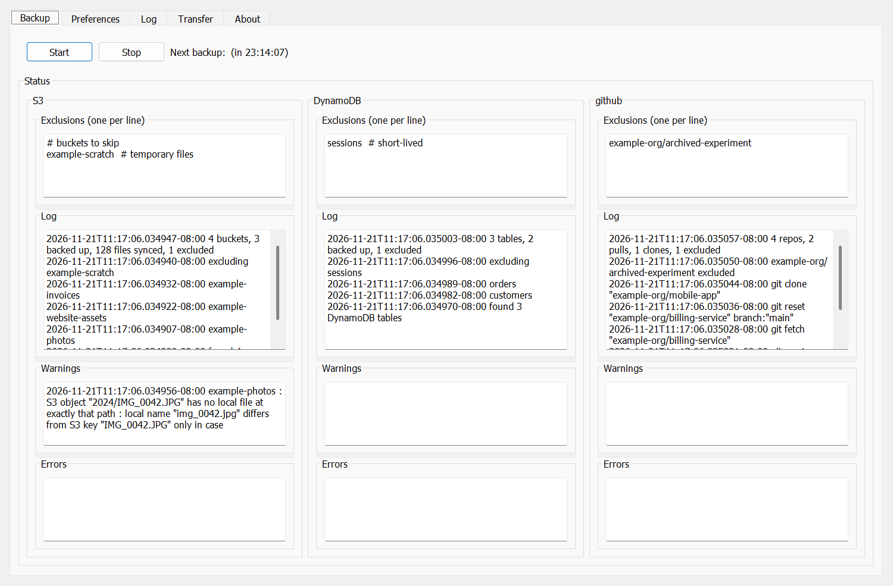
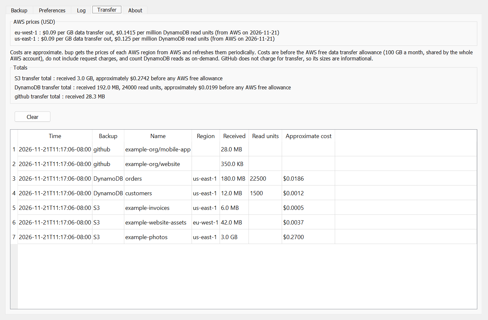

<p align="center">
    <a href="https://github.com/jamesabel/bup/actions/workflows/ci.yml">
        
    </a>
    <a href="https://codecov.io/gh/jamesabel/bup">
        
    </a>
    <a href="https://pypi.org/project/bup/">
        
    </a>
    <a href="https://pypi.org/project/bup/">
        
    </a>
    <a href="https://pypi.org/project/bup/">
        
    </a>
    <a href="https://github.com/jamesabel/bup/blob/main/LICENSE">
        
    </a>
    <a href="https://github.com/psf/black">
        
    </a>
</p>

# bup

bup backs up your cloud data to a local directory: every AWS S3 bucket, every AWS DynamoDB table and every GitHub
repository your credentials can see. Point it at a backup directory, give it an AWS profile and a GitHub token, and it
keeps a local copy up to date, either on demand or automatically every so many hours.

It has a GUI for everyday use and a command line for scripts and scheduled jobs.

- **S3:** each bucket is synced with `aws s3 sync`, so only new and changed objects are downloaded. Objects deleted
  from S3 are kept locally. Each sync is checked against the bucket's contents.
- **DynamoDB:** each table is saved in full, as both a pickle file and a JSON file.
- **GitHub:** each repository is cloned, and every branch is kept an exact mirror of the remote.
- **Exclusions:** skip particular buckets, tables or repos, with comments to say why.
- **Transfer and cost:** see how much each backup downloaded and approximately what AWS charges for it.
- **Logs:** warnings and errors are shown per backup type, with a detailed log of everything bup did.

## Screen captures

These show made-up example data.

The Backup tab runs the backups and shows each backup type's exclusions, progress, warnings and errors:



The Transfer tab shows what each bucket, table and repo downloaded, and the approximate AWS cost:



The Preferences tab holds the backup directory, credentials and the automatic backup schedule:


## Install

bup needs Python 3.13 or later, and `git` on the PATH for GitHub backups. The AWS CLI it uses is installed with it.

```
pip install bup
```

## Use

Run `bup` with no arguments for the GUI. Set the backup directory and credentials in the Preferences tab, then press
Start in the Backup tab (or enable the automatic backup).

Give `bup` a backup directory and what to back up for the command line:

```
bup D:\backup -s                 # S3
bup D:\backup -d                 # DynamoDB
bup D:\backup -a -p my-profile   # S3 and DynamoDB, with an AWS profile
bup D:\backup -g -t <token>      # GitHub (the token is saved for later runs)
bup D:\backup -s --dry_run       # show what an S3 backup would do
bup --help                       # all the options
```

The backup directory gets a directory per backup type: `s3/<bucket>/`, `dynamodb/<table>.pickle` and
`dynamodb/<table>.json`, and `github/<owner>/<repo>/`.

# Exclusions

Each backup type (S3, DynamoDB, GitHub) has an exclusion list: names to skip, one per line. S3 entries are bucket
names, DynamoDB entries are table names, and GitHub entries are either a repo name (`my-repo`) or `owner/my-repo`.
Exclusion lists are edited in the GUI's "Exclusions" box for each backup type.

The same syntax applies to all three lists (S3 buckets, DynamoDB tables, and GitHub repos):

- `#` starts a comment that runs to the end of the line. This works for whole-line comments and for inline
  trailing comments, e.g. `my-bucket  # too big, backed up elsewhere`.
- Blank and whitespace-only lines are ignored.
- Leading and trailing whitespace around a name is ignored, so `  my-bucket ` matches `my-bucket`.
- Names are matched exactly (no wildcards).

```
# S3 buckets to skip
logs-archive        # 2 TB, backed up by a lifecycle rule instead
scratch-bucket
```

# S3 backup verification

After each bucket is synced (`aws s3 sync`, deliberately without `--delete` so that objects deleted from S3 are
kept in the local backup), bup lists the bucket with boto3 and compares its total size in bytes to the total size
of the local backup directory. The comparison is by bytes, not by object count, because `aws s3 sync` does not
copy zero-length objects. The S3 object count and the local file count are included in the result line for
reference only.

There are three outcomes:

- **S3 is larger than the local backup** - something was not backed up. This is reported as an **error** in the
  backup output (the GUI's "Backup" tab, or the CLI's console output, where it also makes the CLI exit with a
  non-zero status).
- **Local backup is larger than S3** - expected over time, since deletions in S3 are retained locally. Logged as
  info only.
- **Match** - logged as info only.

The info-level result lines are not shown in the backup output. They go to the application log: in the GUI this is
the "Log" tab (the "AWS S3" pane), and in the CLI it is the console with `-v`/`--verbose`. If a detailed log
directory is configured in Preferences, each backup type's log also goes to its own file there (`s3.log`,
`dynamodb.log`, `github.log`, `application.log`). A result line looks like:

```
my-bucket : local backup is larger than S3 (files deleted from S3 are retained locally) (synced=3, s3_count=120, local_count=125; s3_total_size=10485760, local_size=10520000)
```

## A lower local file count, and files that download every run

`aws s3 sync` matches each S3 key against the local relative path as an exact string. Two consequences show up
in the result lines, and bup explains both - and fixes the second:

- **Fewer local files than S3 objects** (`local_count` below `s3_count`). When this happens, bup lists the bucket
  again and compares the keys to the local files. Zero-byte objects whose key ends in `/` (the S3 console's
  "Create folder") are *folder markers* - `aws s3 sync` never downloads them, so they are expected to be absent and
  are listed in the application log as info. Any other object with no local file at exactly its path is a
  **warning** in the backup output, naming the object and, when a similarly named local file or directory exists,
  how the names differ.
- **A file that is downloaded on every run** even though it is already backed up. On Windows, file names are
  case-insensitive and trailing spaces and dots are stripped, so a download can land in an existing file or
  directory whose on-disk name differs from the S3 key. Sync then never sees an exact match and downloads the
  file again each run. After each sync, bup checks the local name of every downloaded file against its key and,
  since the download just made is the current version, **renames the local file or directory to the key's exact
  name** (outermost component first - renaming a directory fixes everything under it at once). Each rename is
  reported as info in the backup output, and the next sync finds the file already backed up. A name the file
  system cannot store (e.g. a key ending in a space, on Windows) or a rename that fails is a **warning** naming
  the file and the reason. A dry run renames nothing and reports the mismatch as a warning instead.

```
my-bucket : renamed "D:\b\s3\my-bucket\static\Vendor" to "vendor" to match the S3 key "static/vendor/select2.js" so the next sync finds it already backed up
```

### How S3 key case is handled

S3 keys are case-sensitive: `Photos/IMG_1.jpg` and `photos/img_1.jpg` are two different objects. bup never changes
or folds the case of a key - the local path of every object is made to match its key exactly, character for
character, on every platform.

- **Case-sensitive file systems** (Linux, and macOS or Windows volumes formatted case-sensitive): the local path is
  always the key as-is, so case needs no special handling and keys that differ only in case are stored as separate
  files.
- **Case-insensitive file systems** (the Windows default, and macOS by default): a download can land in an existing
  file or directory whose name differs from the key only in case, e.g. a key `static/vendor/select2.js` landing
  under an existing `static\Vendor` directory. `aws s3 sync` compares names as exact strings, so it would never
  see a match and would download that object again on every run. After each sync, bup compares the local name of
  every downloaded file to its key, component by component, and renames any that differ only in case (or only in
  Unicode normalization, or by a trailing space or dot) to the key's exact spelling, reporting each rename as
  info. A dry run reports the mismatch as a warning instead of renaming.
- **Keys that differ only in case** (`Readme.md` and `readme.md` in the same prefix) cannot both exist on a
  case-insensitive file system: they share one local file, so bup reports a case mismatch and re-downloads them on
  every run. Back up such a bucket to a case-sensitive file system to keep both objects.

# Transfer and approximate AWS cost

AWS charges for data sent out to the internet, which is what a backup is. bup reports what each backup received and
approximately what AWS charges for it. In the GUI this is in the "Transfer" tab (and the application log), with one row
per S3 bucket, DynamoDB table or GitHub repo that received anything and a total per backup type. The CLI prints the
same lines in its regular output.

- **S3:** the total size of the files `aws s3 sync` downloaded, priced as data transfer out.
- **DynamoDB:** the size of the table scan responses, priced as data transfer out, plus the read units the scan
  consumed, priced as on-demand reads. Tables are only scanned when they have changed or about once a day, so many
  runs receive nothing.
- **GitHub:** how much the local repository grew from a clone or fetch. GitHub does not charge for this, so it is
  informational only (e.g. to notice a repo that suddenly transfers a lot).

The costs are estimates:

- bup gets the prices itself, so there is nothing to enter. AWS prices differ by region, so each S3 bucket is priced
  at the rates of the region it is in and each DynamoDB table at the rates of the region it is read from. The prices
  come from the public AWS Price List files at `pricing.us-east-1.amazonaws.com` (no AWS credentials or permissions
  are needed), are cached in a local SQLite database (`aws_prices.db` in
  bup's user cache directory), and are fetched again when they are more than a week old. The Transfer tab shows the
  prices in use and when they were fetched.
- If the prices can not be fetched (e.g. the price list is unreachable) the previously fetched prices are used. If
  there are none yet, the transfer is reported without a cost.
- Volume discounts are not applied (the price used is that of the first 10 TB a month).
- AWS does not charge for the first 100 GB of data transfer out a month, shared by the whole AWS account. bup does
  not know how much of that allowance is left, so the cost shown is before the allowance - the most the transfer could
  cost, not necessarily what you are billed.
- Request charges (e.g. S3 GET and LIST) are not included.
- DynamoDB reads are priced as on-demand. A table with provisioned capacity has already paid for its reads.
- A dry run reports nothing, since nothing is transferred.

# Security Notes

- Credentials you enter (AWS secret access key, GitHub token) are stored **unencrypted** in a local
  SQLite preferences database in your user profile. Prefer AWS profiles (`~/.aws/credentials`) over
  raw keys where possible, and treat the preferences database with the same care as a credentials file.
- GitHub authentication for clone/pull is passed to git via the process environment, so the token is
  not written into each backup's `.git/config`. Backups made by older versions of bup may still have
  a token embedded in their remote URL; bup scrubs these the next time each repo is pulled.

# Acknowledgements 

<div>Icons made by <a href="https://www.freepik.com" title="Freepik">Freepik</a> from <a href="https://www.flaticon.com/" title="Flaticon">www.flaticon.com</a></div>
