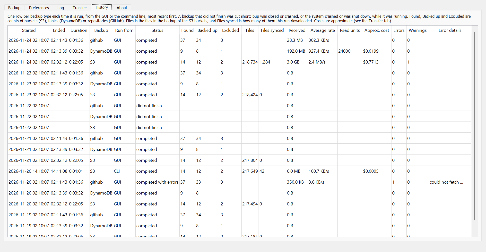
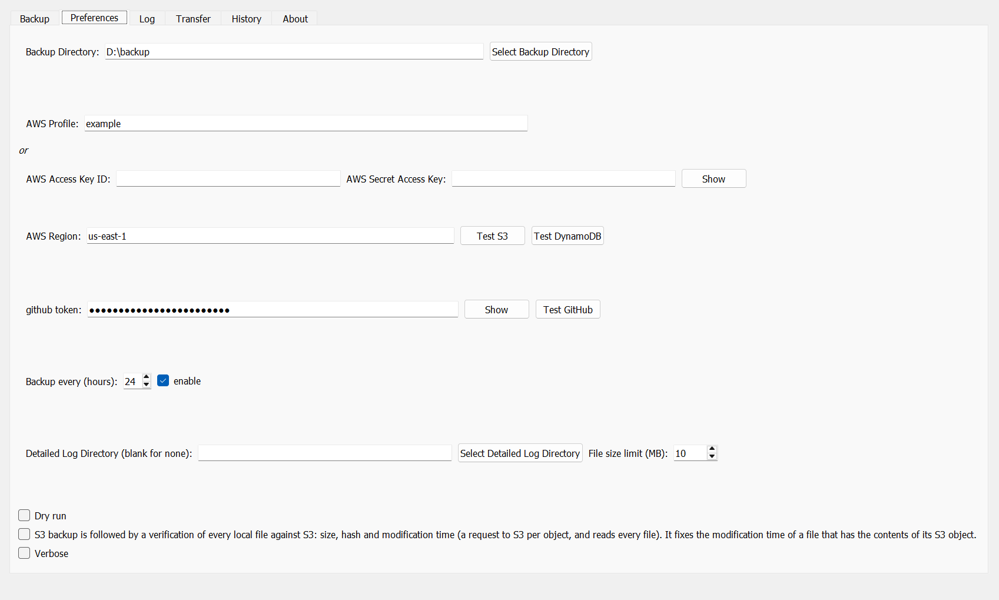

<p align="center">
    <a href="https://github.com/jamesabel/bup/actions/workflows/ci.yml">
        
    </a>
    <a href="https://codecov.io/gh/jamesabel/bup">
        
    </a>
    <a href="https://pypi.org/project/bup/">
        
    </a>
    <a href="https://pypi.org/project/bup/">
        
    </a>
    <a href="https://pypi.org/project/bup/">
        
    </a>
    <a href="https://github.com/jamesabel/bup/blob/main/LICENSE">
        
    </a>
    <a href="https://github.com/astral-sh/ruff">
        
    </a>
</p>

# bup

bup backs up your cloud data to a local directory: every AWS S3 bucket, every AWS DynamoDB table and every GitHub
repository your credentials can see. Point it at a backup directory, give it an AWS profile and a GitHub token, and it
keeps a local copy up to date, either on demand or automatically every so many hours.

It has a GUI for everyday use and a command line for scripts and scheduled jobs.

- **S3:** each bucket is synced to a local directory, so only new and changed objects are downloaded. Objects deleted
  from S3 are kept locally. Every download is checked against the S3 object.
- **DynamoDB:** each table is saved in full, as both a pickle file and a JSON file.
- **GitHub:** each repository is cloned, and every branch is kept an exact mirror of the remote.
- **Exclusions:** skip particular buckets, tables or repos, with comments to say why.
- **Transfer and cost:** see how much each backup downloaded and approximately what AWS charges for it.
- **History:** every backup run is on record, with when it ran, how it ended, how many buckets, tables or repos and
  files it backed up, what it downloaded and its errors. If a
  backup was cut short (e.g. by a system crash), bup says so the next time it is started.
- **Logs:** warnings and errors are shown per backup type, with a detailed log of everything bup did.

## Screen captures

These show made-up example data.

The Backup tab runs the backups and shows each backup type's exclusions, progress, warnings and errors:


The Transfer tab shows what each bucket, table and repo downloaded, and the approximate AWS cost:


The History tab shows the backup runs on record, and how each one ended:



The Preferences tab holds the backup directory, credentials and the automatic backup schedule:



## Install

bup needs Python 3.13 or later, and `git` on the PATH for GitHub backups. S3 and DynamoDB need nothing else (bup does
not use the AWS CLI).

```
pip install bup
```

## Use

Run `bup` with no arguments for the GUI. Set the backup directory and credentials in the Preferences tab, then press
Start in the Backup tab (or enable the automatic backup).

Stop asks the running backups to stop, which they do at the next point where they can, so it can take a while. The
status line at the bottom of the window says that the backup is stopping, and then when it stopped. A backup you
stopped is not started again by the automatic backup until the backup period has passed since the stop (press Start to
run it sooner). It is not a completed backup: if bup is closed and started again, the automatic backup counts from the
most recent backup that completed.

Give `bup` a backup directory and what to back up for the command line:

```
bup D:\backup -s                 # S3
bup D:\backup -d                 # DynamoDB
bup D:\backup -a -p my-profile   # S3 and DynamoDB, with an AWS profile
bup D:\backup -g -t <token>      # GitHub (the token is saved for later runs)
bup D:\backup -s --dry_run       # show what an S3 backup would do
bup D:\backup -s --verify        # S3, then verify every local file against S3
bup --help                       # all the options
```

The backup directory gets a directory per backup type: `s3/<bucket>/`, `dynamodb/<table>.pickle` and
`dynamodb/<table>.json`, and `github/<owner>/<repo>/`.

# Exclusions

Each backup type (S3, DynamoDB, GitHub) has an exclusion list: names to skip, one per line. S3 entries are bucket
names, DynamoDB entries are table names, and GitHub entries are either a repo name (`my-repo`) or `owner/my-repo`.
Exclusion lists are edited in the GUI's "Exclusions" box for each backup type.

The same syntax applies to all three lists (S3 buckets, DynamoDB tables, and GitHub repos):

- `#` starts a comment that runs to the end of the line. This works for whole-line comments and for inline
  trailing comments, e.g. `my-bucket  # too big, backed up elsewhere`.
- Blank and whitespace-only lines are ignored.
- Leading and trailing whitespace around a name is ignored, so `  my-bucket ` matches `my-bucket`.
- Names are matched exactly (no wildcards).

```
# S3 buckets to skip
logs-archive        # 2 TB, backed up by a lifecycle rule instead
scratch-bucket
```

# S3 backup

Each bucket is synced to `s3/<bucket>/` with [awsimple](https://github.com/jamesabel/awsimple)'s
`S3Access.sync_to_directory()`, which works like `aws s3 sync` from a bucket to a directory:

- The bucket is listed once. An object is downloaded when its local file is missing, has a different size, or is
  older than the S3 object. With the "size only" preference (`--size_only`) modification times are not compared.
- A download goes to a temporary file, which only replaces the local file once its length and checksum (S3's
  CRC64NVME, when the object has one) are those of the S3 object. The local file gets the modification time of the
  S3 object.
- Local files are never deleted, so objects deleted from S3 are kept in the local backup.
- Each bucket is accessed in the region it is in, whichever region is set in Preferences.
- A dry run downloads nothing and reports how many files would be synced.
- Stop lets the downloads that have started finish, and starts no others.

## What is reported

Every object a sync downloads is in the application log. In the backup output (the GUI's "Backup" tab, or the CLI's
console output):

- **An object that could not be downloaded** (or whose key can not be a local file, e.g. one with a `..` part, or on
  Windows a `:` or a backslash) is an **error**, with the reason. The sync goes on with the other objects. In the CLI
  an error also makes the exit status non-zero.
- **An object that is not backed up on purpose** is a **warning**, with the reason:
  - objects in the `GLACIER` or `DEEP_ARCHIVE` storage class, which have to be restored before they can be read
  - keys that would be the same local file (see below)
  - a key that is a file where other keys need a directory (`a` when there is also `a/b`)
- **Folder markers** (keys that end in `/`, e.g. from the S3 console's "Create folder") are not files, so they are
  never downloaded. They are expected to be absent and are only listed in the application log, as info.

At most 20 objects are named per bucket for each of these, followed by how many more there are.

## Verification

After a bucket is synced, bup lists the bucket again with boto3 (a listing of its own, not the sync's) and compares
the bucket's total size in bytes to the total size of the local backup directory. The objects the sync reported as
not downloaded (see above) are left out of the S3 total, since they have already been reported. If the bucket can
not be listed, that is an **error** and the bucket is not verified. Otherwise there are three outcomes:

- **S3 is larger than the local backup** - something that should be there is not. This is reported as an **error**.
- **Local backup is larger than S3** - expected over time, since deletions in S3 are retained locally. Logged as
  info only.
- **Match** - logged as info only.

The info-level result lines are not shown in the backup output. They go to the application log: in the GUI this is
the "Log" tab (the "AWS S3" pane), and in the CLI it is the console with `-v`/`--verbose`. If a detailed log
directory is configured in Preferences, each backup type's log also goes to its own file there (`s3.log`,
`dynamodb.log`, `github.log`, `application.log`). A result line looks like:

```
my-bucket : local backup is larger than S3 (files deleted from S3 are retained locally) (synced=3, not_backed_up=0, failed=0, s3_count=120, local_count=125; s3_total_size=10485760, backed_up_size=10485760, local_size=10520000)
```

A bucket that was stopped part way is not verified.

## Verifying every file against S3 (optional)

The check above is of total sizes. With "S3 backup is followed by a verification of every local file against S3"
set in Preferences (`--verify` on the command line), bup also checks every file once all the buckets are backed
up. It is off by default because it takes a while and costs something: it makes a request to S3 for the metadata
of every object and reads every local file to hash it, on every run. AWS charges for these requests by the storage
class of the object: about $0.0004 per 1000 for STANDARD objects, and about $0.01 per 1000 (25 times that) for
Glacier Instant Retrieval objects. bup reports the requests of each bucket's verification and their approximate
cost (see "Transfer and approximate AWS cost").

The verification is awsimple's `S3Access.verify_directory()`. For every S3 object the sync says has a current local
file (downloaded in this run, or already up to date), the local file is compared to the metadata of the S3 object:

- **Size.**
- **Hash** of the contents, with the strongest hash of the whole object that S3 has: a SHA-512 (S3's own, or the
  one awsimple writes as object metadata), otherwise S3's SHA-256, SHA-1, CRC64NVME, CRC32C or CRC32 checksum.
  S3 only has a checksum of an object that was written with one, and the checksum of an object that was uploaded
  in parts can be of the parts rather than the whole. Such an object has no hash to compare, so only its size and
  modification time are checked, and the result line says how many there were.
- **Modification time.** A file gets the modification time of its S3 object when it is downloaded. Times within
  10 seconds are the same, to allow for the time resolutions of S3 and of file systems.

A file that is missing or whose size or hash is not the S3 object's is an **error**, and so is a file that could not
be verified (e.g. the metadata of its S3 object could not be had). A file with the contents of
the S3 object but another modification time is a **warning** (e.g. with "size only" set, an object that was
written to S3 again with the same size is not downloaded again). At most 20 files are named per bucket for each.
Each bucket has a result line in the backup output, followed by a total:

```
my-bucket : verified 120 of 120 files against S3 : 0 differ, 0 have a different modification time, 3 have no hash in S3 (size and modification time only)
verified 120 files in 1 buckets against S3, 0 differ
```

If S3 can no longer be reached during the verification (e.g. the internet connection drops), the verification ends
there. When 3 files in a row can not be verified, bup asks S3 about the bucket: with no answer, those files and the
ones that are left are one **error** for the bucket, and the buckets after it are not verified. With an answer, the
files failed for reasons of their own and the verification goes on.

```
my-bucket : S3 could not be reached during the verification, which ended there : 80 of 120 files were not verified : Could not connect to the endpoint URL: "https://my-bucket.s3.us-west-2.amazonaws.com/"
verified 40 files in 1 buckets against S3, 0 differ (S3 could not be reached, so the verification ended : 2 more buckets were not verified)
```

A dry run is not verified, and Stop ends the verification.

## S3 keys and local file names

An S3 key is any string, and a local file name is not. bup never changes the name a file already has in the backup.

- **Case.** S3 keys are case-sensitive: `Photos/IMG_1.jpg` and `photos/img_1.jpg` are two different objects. On a
  case-sensitive file system (Linux) they are two files. Where file names that only differ in case are the same file
  (Windows and macOS), the local file of a key is found whatever its case on disk, e.g. the key
  `static/vendor/select2.js` under an existing `static\Vendor` directory, so it is not downloaded again. Keys that
  only differ in case can not both be stored there: none of them is downloaded, and each is a warning. Back up such a
  bucket to a case-sensitive file system to keep them all.
- **Keys that start with "/" or contain "//"** (e.g. `/temp/report.json`). A local path can not have an empty part,
  so the object is stored without it (`temp/report.json` inside the bucket's backup directory, never outside of it),
  and is found there on the next run. If two keys only differ by such a "/" (`a/b` and `a//b`) they would be the same
  local file: neither is downloaded, and each is a warning.

# Transfer and approximate AWS cost

AWS charges for data sent out to the internet, which is what a backup is, and for the requests that are made to S3.
bup reports what each backup received and approximately what AWS charges for it. In the GUI this is in the
"Transfer" tab (and the application log), with one row per S3 bucket, DynamoDB table or GitHub repo that received
anything or made S3 requests (sorted by cost, highest at the top), a total per backup type and a grand total. The
CLI prints the same lines in its regular output.

- **S3:** the total size of the objects the sync downloaded, priced as data transfer out, plus the requests that
  were made to S3 for the bucket, which awsimple counts (`S3Access.usage`). A request is priced by its tier: a
  listing is tier 1 (about $0.005 per 1000), and a request for an object or its metadata is tier 2, priced by the
  storage class of the object (about $0.0004 per 1000 for STANDARD, $0.001 for STANDARD_IA and ONEZONE_IA, and
  $0.01 for GLACIER_IR). A bucket is reported even when nothing was downloaded, since finding that out makes
  requests. With the verification, each bucket has a second row for the requests of its verification, e.g.:

  ```
  my-bucket : received 1.2 GB, 1310 S3 requests, approximately $0.1093 before any AWS free allowance
  my-bucket (verification) : received 0 B, 48200 S3 requests, approximately $0.4820 before any AWS free allowance
  ```
- **DynamoDB:** the size of the table scan responses, priced as data transfer out, plus the read units the scan
  consumed, priced as on-demand reads. Tables are only scanned when they have changed or about once a day, so many
  runs receive nothing.
- **GitHub:** how much the local repository grew from a clone or fetch. GitHub does not charge for this, so it is
  informational only (e.g. to notice a repo that suddenly transfers a lot).

The costs are estimates:

- bup gets the prices itself, so there is nothing to enter. AWS prices differ by region, so each S3 bucket is priced
  at the rates of the region it is in and each DynamoDB table at the rates of the region it is read from. The prices
  come from the public AWS Price List files at `pricing.us-east-1.amazonaws.com` (no AWS credentials or permissions
  are needed), are cached in a local SQLite database (`aws_prices.db` in
  bup's user cache directory), and are fetched again when they are more than a week old. The Transfer tab shows the
  prices in use and when they were fetched.
- If the prices can not be fetched (e.g. the price list is unreachable) the previously fetched prices are used. If
  there are none yet, the transfer is reported without a cost.
- Volume discounts are not applied (the price used is that of the first 10 TB a month).
- AWS does not charge for the first 100 GB of data transfer out a month, shared by the whole AWS account. bup does
  not know how much of that allowance is left, so the cost shown is before the allowance - the most the transfer could
  cost, not necessarily what you are billed.
- The retrieval fee that some S3 storage classes have per GB read (e.g. STANDARD_IA and GLACIER_IR) is not
  included.
- The S3 requests that are not for one bucket are not included: the listing of the buckets, and a request for
  the region of each bucket.
- A storage class that the price list has no request price for is priced as STANDARD.
- DynamoDB reads are priced as on-demand. A table with provisioned capacity has already paid for its reads.
- A dry run downloads nothing, and reports the S3 requests it made to find out what a sync would download.

# Backup history

bup keeps a record of every backup run in a local SQLite database (`backup_history.db` in bup's user data directory),
with one row per backup type (S3, DynamoDB, GitHub) each time it is run, from the GUI or the command line. The GUI
shows it in the "History" tab, most recent first. Each run has:

- when it started and ended, and how long it took
- how many buckets (S3), tables (DynamoDB) or repos (GitHub) it found, how many of them it backed up without an error,
  and how many were excluded (**Found**, **Backed up**, **Excluded**). A dry run backs up nothing, so it has no
  "Backed up" count.
- for S3, the total number of files in the backup of the buckets it synced, whenever they were downloaded (**Files**),
  and how many of them this run downloaded (**Files synced**)
- what it received over the network, the average rate over the whole run, the DynamoDB read units, and the approximate
  AWS cost (see "Transfer and approximate AWS cost")
- how many errors and warnings it had, and the error messages (the first 100 of them; the tab shows the first, and the
  rest when the mouse is over it)
- its status:
  - **running** - it has not ended yet
  - **completed** - it got to its end without an error
  - **completed with errors** - it got to its end, but something was not backed up
  - **stopped** - you stopped it, with Stop or by closing bup while it was running ("Stop and Exit")
  - **failed** - an unexpected failure ended it
  - **did not finish** - it was cut short: bup was closed or crashed, or the system crashed or was shut down, while it
    was running. bup finds this out the next time the GUI is started, and says so in the status line at the bottom of
    the window (until bup is closed). What the backup had received up to the last bucket, table or repo it completed
    is on record, but not when it was cut short.

A count is blank if the run did not get far enough to have it (e.g. it could not list the buckets), or if it was
recorded by a bup that did not count it (0.17.0). A history database made by such a bup is kept and gains the counts.

A backup records its row when it starts and completes it when it ends, which is how a run that never got to its end is
found. If the history database can not be written, the backup still runs (and the application log says so).

# Security Notes

- Credentials you enter (AWS secret access key, GitHub token) are stored **unencrypted** in a local
  SQLite preferences database in your user profile. Prefer AWS profiles (`~/.aws/credentials`) over
  raw keys where possible, and treat the preferences database with the same care as a credentials file.
- GitHub authentication for clone/pull is passed to git via the process environment, so the token is
  not written into each backup's `.git/config`. Backups made by older versions of bup may still have
  a token embedded in their remote URL; bup scrubs these the next time each repo is pulled.

# Acknowledgements 

<div>Icons made by <a href="https://www.freepik.com" title="Freepik">Freepik</a> from <a href="https://www.flaticon.com/" title="Flaticon">www.flaticon.com</a></div>
